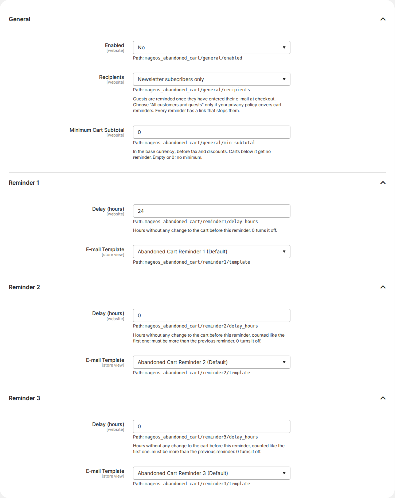

# Abandoned Cart Reminder

`mage-os/module-abandoned-cart` (`MageOS_AbandonedCart`) — a module for Mage-OS / Magento Open Source.

Sends up to three reminder e-mails for abandoned carts, of customers and of guests, each with its own delay and template.

- A cron job runs every 15 minutes and sends the reminders that are due, at most one per cart per run.
- Guest carts are reminded once the e-mail entered at checkout is saved on the cart: after the shipping step on the Luma checkout, as soon as it is typed on Loki Checkout (see [Compatibility](#compatibility)). Their e-mail links to a page that puts the cart back in their session.
- Recipients: newsletter subscribers only (default), or all customers and guests.
- The e-mail lists the items still for sale with their image and price, and the subtotal. A cart whose products are all disabled or out of stock gets no e-mail.
- Every reminder has a *Stop cart reminders* link, and a one-click `List-Unsubscribe` header (RFC 8058, expected by Gmail and Yahoo), that stops all reminders to that address.
- Optional single-use coupon per reminder: pick a cart price rule, and each reminder sent carries a new code generated from it.
- A report under *Reports > Marketing > Abandoned Cart Reminders* counts the reminders sent, the cart links followed and the orders placed within the attribution window after a reminder, and lists the history of every reminder, with the reason when one was not sent. The same page sends any reminder to yourself as a test.
- Reminder history older than a configurable number of days (365 by default) is deleted every night.
- Optional campaign parameters (`utm_source`, `utm_medium`, `utm_campaign`) on the cart link, for your analytics tool.
- A reminder whose sending fails is tried again one hour later, then six hours later, before being passed over.
- Configuration: *Stores > Configuration > Sales > Abandoned Cart*, per website. Disabled by default.

Limitations: three reminders at most; one coupon rule per reminder; a reminder due while nothing in the cart is for sale is passed over, not sent later; carts unchanged for more than 30 days are not reminded; on the Luma checkout, a guest who stops at the e-mail field without going past the shipping step is not reminded (the e-mail is not saved yet); the campaign parameters have fixed values.

## Compatibility

Mage-OS 3.6 and 4.x, and Magento Open Source 2.4.9: all share the Magento 2.4.9 base (`magento/framework` ^103.0.9). PHP 8.3 to 8.5. CI runs the check-extension workflow on the currently supported Mage-OS versions (today Mage-OS 3.6.0 with PHP 8.4; Mage-OS 4.0 joins once the check-extension actions know it); developed on Mage-OS 4.0.0 with PHP 8.5.

The module adds nothing to any checkout: it reads the guest's e-mail where the checkout saved it, on the cart (`quote.customer_email`) or else on the cart address changed last (`quote_address.email`).

- **Luma** (theme and checkout): supported. The checkout saves the guest e-mail with the shipping address, when the guest leaves the shipping step. Covered by the integration tests run in CI; the 1.4 changes were not run in a browser.
- **Hyvä Theme**: supported. The only storefront page, the confirmation of the stop link, is a plain form styled for both Hyvä and Luma; the module registers itself for Hyvä's Tailwind build.
- **Hyvä Checkout**: not verified, neither run nor read (no licensed install). Guests are reminded if it saves their e-mail in one of the two places above: check it on yours with the query under [Troubleshooting](#troubleshooting).
- **Loki Checkout**: read from its source (2.8.2), not run. Its e-mail field saves the address on the cart (`quote.customer_email`) as soon as it is filled in, so guests are reminded without going past any step. To check: as a guest, type an e-mail in the checkout, leave, and look for the cart with the query under [Troubleshooting](#troubleshooting).
- **Elasticsuite**: nothing to integrate; the module touches neither search nor product lists.

The 1.5 features (coupon, history, attribution window, purge) live in the cron, the order observer and the admin: no storefront or checkout change. The coupon is a standard cart price rule code, entered wherever each checkout takes a coupon. They were checked by PHPStan, PHPCS and unit tests only; not run on a shop.

## Installation

```bash
composer config repositories.mageos-abandoned-cart vcs https://github.com/mage-os-lab/module-abandoned-cart
composer require mage-os/module-abandoned-cart
bin/magento module:enable MageOS_AbandonedCart
bin/magento setup:upgrade
```

## Configuration

### Stores > Configuration > Sales > Abandoned Cart > General

| Setting | Default | Scope | What it does |
|---------|---------|-------|--------------|
| Enabled | No | Website | Turns the reminders on for the website. |
| Recipients | Newsletter subscribers only | Website | *Newsletter subscribers only*: an address subscribed to the newsletter in the cart's website, the subscription being the consent for this marketing e-mail. *All customers and guests*: every cart with an e-mail; choose it only if your privacy policy covers cart reminders. With *Newsletter subscribers only*, set *Customers > Newsletter > Subscription Options > Need to Confirm* to Yes, so nobody can subscribe someone else's address to get it reminders. |
| Minimum Cart Subtotal | 0 | Website | Carts whose subtotal, in base currency before tax and discounts, is below it get no reminder. 0: no minimum. |
| Add Campaign Parameters to the Cart Link | No | Website | Adds `utm_source=abandoned_cart`, `utm_medium=email` and `utm_campaign=reminder_1` (`_2`, `_3`) to the cart link of the reminders, and carries them to the cart page the link opens, so an analytics tool (GA4, Matomo…) credits the visit to the reminder. The values are fixed. Works behind Varnish: see [Campaign parameters and Varnish](#campaign-parameters-and-varnish). |

### Reminder 1, Reminder 2, Reminder 3

| Setting | Default | Scope | What it does |
|---------|---------|-------|--------------|
| Delay (hours) | 24, 0, 0 | Website | Hours without any change to the cart before this reminder. 0 turns the reminder off. Each delay counts from the last change to the cart and must be more than the previous reminder's, otherwise the reminder is skipped. |
| E-mail Template | Abandoned Cart Reminder 1, 2, 3 | Store view | Template of the reminder; copy it under *Marketing > Email Templates* to change the text. |
| Coupon | No coupon | Website | Optional. *No coupon* (the default): the reminder carries no coupon. Otherwise, the cart price rule that generates a new code for each reminder sent, shown in the e-mail (`coupon_code`). See [Coupons](#coupons). |

Reminder n+1 is also never sent sooner than the gap between both delays after reminder n: with 1, 24 and 72 hours, a cart found 3 days old still gets its reminders 23 and 48 hours apart. A change to the cart pushes the next reminder back by its full delay; placing the order stops the reminders. An e-mail address gets at most 3 reminders a week, all carts together, so carts filled in with someone else's address cannot flood it; a reminder over that limit is skipped and the next one follows as usual.

A reminder whose sending fails (mail server down, broken template: "Abandoned cart reminder failed" in `var/log/exception.log`, and in `var/log/debug.log` when debug logging is on) stays due: it is tried again one hour later, then six hours later, and passed over after this third failure, the next reminder following as usual. A change to the cart in the meantime restarts the delay as for any reminder.

### Report and History

| Setting | Default | Scope | What it does |
|---------|---------|-------|--------------|
| Attribution Window (days) | 7 | Global | An order placed from a reminded cart is credited to its last reminder (counted as recovered, with its revenue) only if placed within this many days of it. 0: however late, as before 1.5. |
| Keep History For (days) | 365 | Global | Every night (cron `mageos_abandoned_cart_purge`, 03:40), the reminders and history entries older than this are deleted; the report then shows nothing before that date. 0: keep everything. Addresses that used the stop link are never deleted. The purge runs even while the reminders are disabled. |

### Coupons

Reminders carry no coupon unless you choose a rule for them: *Coupon* is *No coupon* by default for each reminder.

1. Under *Marketing > Cart Price Rules*, create a rule with *Coupon* set to *Specific Coupon* and *Use Auto Generation* checked, its websites, customer groups (include *NOT LOGGED IN* for guests), dates and discount. Set *Uses per Coupon* to 1 for a single-use code, and *Uses per Customer* as you wish.
2. Pick the rule in *Coupon* of the reminders that should carry one (for example only *Reminder 3*).

Each reminder sent then gets its own new code, generated with the length, format and prefix of *Stores > Configuration > Customers > Promotions > Auto Generated Specific Coupon Codes*, and listed with the rule's generated codes. The code is shown in the e-mail and in the history. A rule that is inactive, outside its dates, not for the cart's website or customer group, or that fails to generate a code gives no coupon: the reminder is sent without one, and the history says so. A coupon never stops a reminder: whatever goes wrong while generating the code, the reminder is sent without it and the error is in `var/log/exception.log` (and `var/log/debug.log` when debug logging is on). If the promotion settings were never saved, their format is not a valid one and codes are generated alphanumeric. A code generated for an e-mail that then fails to send is deleted. The test e-mail shows `TEST-COUPON`, which no rule accepts, instead of generating a code.

### Campaign parameters and Varnish

Magento's Varnish configuration removes `utm_*` parameters from the URL before the request reaches Magento, so the restore link cannot read them. It does not need to: the link's token identifies the cart, and the restore page rebuilds the parameters of the cart's last reminder from *Add Campaign Parameters to the Cart Link*, then redirects to `/checkout/cart/?utm_source=…`. Varnish strips them again on that request, but they stay in the address bar, where the analytics script reads them in the browser. The e-mail links still carry the parameters, which changes nothing: without Varnish the restore page gets the same values.

Custom templates made before 1.5 show no coupon: add `{{if coupon_code}}{{var coupon_code}}{{/if}}` to them, or rebuild them from *Abandoned Cart Reminder 1, 2, 3*.

Access to this section needs the *Abandoned Cart* ACL resource (*System > Permissions > User Roles > Stores > Settings > Configuration*).

### Reports > Marketing > Abandoned Cart Reminders

One row per reminder, over the last 7, 30, 90 or 365 days: reminders sent, cart links followed, orders placed from the cart within the attribution window after the reminder, and their revenue (grand total in base currency). An order is credited to the last reminder its cart received if placed within *Attribution Window (days)* of it, whether or not its link was followed; orders placed before 1.5 keep their credit. Access needs the *Abandoned Cart Reminders* ACL resource (*Reports > Marketing*). The figures start with 1.2.0: reminders sent before are not counted.

*History*, under the report, lists every reminder of the period, newest first, 50 per page: date (UTC), cart ID, store view, reminder, outcome and details. *E-mail sent* shows the coupon code, whether the cart link was followed and the order number credited to it. *Not sent* and *Sending failed* give the reason: no product of the cart is for sale any more, the address already got 3 reminders this week, or the e-mail could not be sent (tried again, or passed over after the last try; the error is in `var/log/exception.log` (and `var/log/debug.log` when debug logging is on)). A reminder sent without the coupon its rule should have given is one line, *E-mail sent, without a coupon*, with the reason: the rule is inactive, expired, not for this website or customer group, or could not generate a code. The history shows no e-mail address: the module keeps only their hash. Reasons are recorded from 1.5 on.

*Send a Test E-mail*, under the report, sends the reminder you pick, as the store view you pick renders it (template, language, sender), to the e-mail address of your admin account. It works while the module is disabled, so a template can be checked before the reminders are turned on. The cart shown is a sample: up to three enabled simple products of the store view at their catalog price. Its links open the cart page: there is no cart to restore and the stop link stops nothing.



## Getting started

1. Open *Reports > Marketing > Abandoned Cart Reminders* and send yourself each reminder with *Send a Test E-mail*.
2. Set *Enabled* to Yes. For a classic sequence set the delays of *Reminder 1, 2, 3* to 1, 24 and 72.
3. As a customer subscribed to the newsletter, log in and add a product to the cart, then leave. With *Recipients* set to *All customers and guests*, you can also try as a guest: add a product, go to checkout, enter an e-mail and the shipping address, click *Next*, then leave.
4. Once the cart is older than the first delay, the next cron run (every 15 minutes) sends reminder 1, listing the items with their image and price, with a link back to the cart and a *Stop cart reminders* link.
5. Follow the link, then open *Reports > Marketing > Abandoned Cart Reminders*: the reminder is counted as sent and followed.

The links in the e-mail carry a token per cart, signed with the deployment key (`app/etc/env.php`). The guest's link copies the cart's items into the cart of the browser that opens it, unless a customer is signed in there, and closes the reminded cart: a forwarded link never makes two browsers share one cart. Customers' links open the cart page, where they sign in. The stop link opens a confirmation page; the address is opted out once the visitor confirms, or when the mailbox provider sends the one-click unsubscribe. Guests are greeted without a name, since the name typed at checkout is not checked.

## Upgrading from 1.2

`setup:upgrade` replaces the opted-out addresses by their SHA-256 hash: the module no longer keeps them in clear. The links of reminders sent before the upgrade stop working, since links now carry a signed token: a visitor who follows one gets *This cart is no longer available* or *This link is not valid*, and the next reminder brings working links.

## Upgrading from 1.1

Nothing to do for the settings: they keep their values, now read per website. A custom template made from a 1.1 template keeps working but shows no image, price or subtotal: rebuild it from the new *Abandoned Cart Reminder 1, 2, 3*, or add `item.image_url`, `item.price` and `subtotal` to it. Customers' cart links now go through the module's restore link, which opens the cart page as before.

## Upgrading from 1.0

`setup:upgrade` moves the 1.0 *Delay (hours)* and *E-mail Template* settings to *Reminder 1* and counts the carts already reminded as having received reminder 1. A custom template made from the 1.0 *Abandoned Cart Reminder* keeps working: its unsubscribe link now stops cart reminders. Its cart link (`checkout/cart`) does not restore guest carts, and its text still mentions the newsletter: rebuild it from *Abandoned Cart Reminder 1* to use `cart_url`.

## Troubleshooting

- **No coupon in the e-mail**: *Coupon* is not set for this reminder, the template predates 1.5 (see [Coupons](#coupons)), or the rule cannot give this cart a code: the history says *E-mail sent, without a coupon*, and a generation error is in `var/log/exception.log` (and `var/log/debug.log` when debug logging is on) ("Abandoned cart reminder coupon not generated").
- **Nothing happens**: Magento cron must run (`bin/magento cron:run` every minute from the system crontab). Check `cron_schedule` for `mageos_abandoned_cart_reminders`.
- **A customer gets nothing**: they are not subscribed to the newsletter (*Customers > Newsletter Subscribers*) while *Recipients* is *Newsletter subscribers only*, the module is off for the cart's website, the subtotal is below *Minimum Cart Subtotal*, no product of the cart is for sale any more, the cart is empty, converted or older than 30 days, all reminders were sent, the address used the stop link (table `mageos_abandoned_cart_optout`, keyed by `SHA2(LOWER('address'), 256)`; delete the row to resume), or the address already got 3 reminders this week.
- **A guest gets nothing**: no e-mail is saved on the cart yet; on the Luma checkout the guest did not get past the shipping step. To see what a checkout saved, and when: `SELECT q.entity_id, q.customer_email, a.address_type, a.email FROM quote q LEFT JOIN quote_address a ON a.quote_id = q.entity_id WHERE q.is_active = 1 ORDER BY q.updated_at DESC LIMIT 10;`
- **A reminder is late**: its sending failed and it waits for its next try (`quote.abandoned_reminder_failures`, `quote.abandoned_reminder_retry_at`, in UTC); the reason is in `var/log/exception.log` (and `var/log/debug.log` when debug logging is on).
- **"This cart is no longer available"**: the order was placed, the items were already restored by an earlier click (the reminded cart is then closed), the link predates 1.3.0, or it was altered.
- **E-mail not delivered**: check *Stores > Configuration > Advanced > System > Mail Sending Settings* and the mail log.

## More

- [CHANGELOG](CHANGELOG.md)
- [Security policy](SECURITY.md)
- [License](LICENSE.txt): Open Software License 3.0. This module contains no code from Adobe Commerce.
